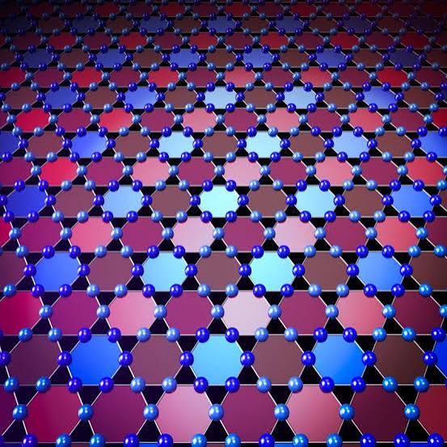

# Kagome Lattice Visualizer

## Description

This project aims to develop Python software for generating and visualizing ideal two-dimensional Kagome lattices. Users will be able to choose lattice dimensions, calculate site positions, and introduce atomic vacancies. The project is motivated by the study of Kagome materials and their structural properties.

## Kagome Lattice Structure

A Kagome lattice is a two-dimensional network of corner-sharing triangles with three sites in its primitive unit cell [1, 2]. Its geometry makes it a useful model for exploring the interplay of lattice structure, magnetism, and electronic properties [1–3].



*Figure 1. Illustrative visualization of a Kagome-like network. The image is a conceptual illustration, not an atomically validated crystal structure or a specific material.*

## Planned Features

- Generate ideal two-dimensional Kagome lattices.
- Calculate site positions for a specified number of unit cells.
- Visualize the lattice with Matplotlib.
- Introduce selected atomic vacancies.
- Save generated positions and figures.

## Python Libraries

- NumPy
- Matplotlib

## Planned Project Structure

```text
myphysics/
├── README.md
├── LICENSE
├── images/
│   └── kagome_lattice.png
├── physics/
│   ├── __init__.py
│   ├── kagome.py
│   ├── defects.py
│   └── visualization.py
├── tests/
└── examples/
```

The planned `KagomeLattice` class in `kagome.py` will represent the lattice and generate its coordinates. `defects.py` will remove selected sites, and `visualization.py` will display the resulting geometry. The structure above is a **plan**, not a claim that every file is implemented.

## Status

Under development. The lattice-generation, vacancy, and visualization functionality described above is planned and has not yet been completed.

## References

1. Yin, J.-X., Lian, B., and Hasan, M. Z. (2022). *Topological kagome magnets and superconductors*. **Nature 612**, 647–657. https://doi.org/10.1038/s41586-022-05516-0
2. Wang, Y. et al. (2023). *Quantum states and intertwining phases in kagome materials*. **Nature Reviews Physics 5**, 635–658. https://doi.org/10.1038/s42254-023-00635-7
3. Jovanovic, M., and Schoop, L. M. (2022). *Simple Chemical Rules for Predicting Band Structures of Kagome Materials*. **Journal of the American Chemical Society 144**, 10978–10991. https://doi.org/10.1021/jacs.2c04183
